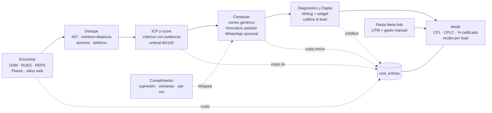

# Faro

> **Una pyme describe a su cliente ideal y Faro lo busca en fuentes gratuitas, lo contacta, se lo pasa a Dapta para calificarlo y le dice cuánto le costó cada lead según dónde lo encontró, comparado con la pauta.**

Proyecto del **30X Hackathon · Reto Dapta "Más leads, menor costo"**. Pregunta que responde: *¿dónde me conviene buscar clientes y cuánto me cuesta cada uno?*

- Especificación maestra: [`SPEC.md`](SPEC.md) · sub-specs por feature: [`specs/`](specs) · decisiones: [`DECISIONS.md`](DECISIONS.md).
- Nombre de trabajo "Faro" (configurable con `NEXT_PUBLIC_PRODUCT_NAME`).

## Acceso

- **App en vivo:** https://faro-eight-sage.vercel.app (ganadora del 30X Hackathon · Reto Dapta).
- **Panel solo con login:** [`/app/login`](https://faro-eight-sage.vercel.app/app/login) con la clave del equipo (`APP_ACCESS_KEY`). El acceso de evaluador del hackathon se retiró (F23). Siguen públicas la landing, los diagnósticos `/d/*`, la baja y los webhooks (con secreto).
- **Qué mirar, en orden:**
  1. `/app/dashboard`: panel **"Reto Dapta: cumplimiento en vivo"**, cada requisito del brief con su número real (los datos de prueba no cuentan).
  2. `/app/hunts`: búsquedas reales (clínicas dentales en Bogotá; contabilidad en Bogotá y Medellín) y "Ver mapa y leads".
  3. Un diagnóstico de los que recibieron las empresas, p. ej. [`/d/rxsfucxl`](https://faro-eight-sage.vercel.app/d/rxsfucxl): oportunidades leídas de **su propio sitio** y cruzadas con los servicios del equipo, comparación con su competencia real y chat de Dapta.
  4. `/app/new`: describe un cliente ideal ("clínicas dermatológicas o spas en Medellín") y mira la búsqueda en vivo.
- **Estado real al 18 oct 2026 (sin datos demo):** 2 búsquedas reales · 8.045 empresas únicas de 4 fuentes (RUES, OpenStreetMap, REPS, sitios web) · 131 duplicados fusionados · 55 del perfil · 29 correos reales enviados desde `equipo@mokub.co` · 7 empresas abrieron su diagnóstico · 0 personas naturales contactadas · CPL ≈ USD 0,02. Las respuestas y la calificación con Dapta llegan solas al tablero cuando una empresa contesta o conversa con el agente; el CPLC muestra "n/d" hasta el primer calificado (con una proyección rotulada "supuesto").

## El reto y cómo lo cubre Faro

Dapta ayuda a las pymes a convertir leads, pero 3 de cada 5 leads que llegan a Dapta preguntan si también les ayudan a conseguirlos. El brief pide una plataforma que **encuentre** leads en fuentes públicas gratuitas, los **contacte** y mida el **costo por lead (CPL) por canal**; opcionalmente los califica con Dapta. Cerrar la venta queda fuera.

| Requisito del brief | Feature | Estado |
|---|---|---|
| ≥ 2 fuentes públicas y gratuitas | F03 OpenStreetMap/Overpass, F04 datos.gov.co (RUES, REPS) y F21 datos.gov.co (SECOP II, RNT, Supersolidaria); extra: F05 Google Places (API oficial), F06 enriquecimiento web | Hecho (F05 en modo mock sin llave) |
| Un solo lugar y sin duplicados | F01 modelo de datos, F07 dedupe multi-fuente (NIT, nombre trigram + 80 m, dominio, teléfono) | Hecho |
| Filtrar por cliente ideal (ICP) | F08 ICP en lenguaje natural + score 0–100 con evidencia | Hecho (IA en modo mock sin llave) |
| Primer mensaje y registrar la respuesta | F10 outreach (correo + formulario asistido), F12 página de diagnóstico `/d/[slug]`, F11 registro de respuestas | Hecho (F10, F11, F12) |
| Tablero con leads y CPL por canal | F13 costos y recibo, F14 tablero | Hecho |
| Solo datos públicos de empresas, términos y ley | F09 cumplimiento (solo persona jurídica, correos genéricos, opt-out, ventanas) | Hecho |
| Enviar a Dapta para calificar | F15 (`widget_only`, `http_push`, `csv_export`, webhook con secreto) | Hecho |
| Comparar canales por CPL, % calificado y CPLC | F14 (matriz fuente × canal, intervalos Beta 90 %) | Hecho |
| Pauta como canal de control | F16 Meta Ads (UTM, `meta_ads` como fuente, gasto manual o CSV) | Hecho |
| WhatsApp (opcional) | F17 export CSV de secuencias para Dapta + webhook; detrás de `WHATSAPP_ENABLED` | Hecho, apagado por defecto |
| Experiencia de demo | F18 landing + video; F19 búsqueda en vivo con mapa; F20 recomendación + bandit | F18, F19 y F20 hechos |

### Lo que se agregó en vivo (17–18 oct)

- **Enriquecimiento con Apify:** al terminar una búsqueda (casilla "enriquecer sitios web con Apify"), Faro busca en Google el sitio de las empresas sin web ni correo (Google Search Scraper, 4 corridas en paralelo, hasta 1.000 por búsqueda; solo acepta dominios que contienen el nombre de la empresa, nunca directorios, Maps ni redes) y luego extrae contactos genéricos con el Contact Details Scraper. Costo real (`usageTotalUsd`) prorrateado por lead. En contabilidad: 150 empresas buscadas → 39 sitios → 39 nuevos leads del perfil por USD 0,56.
- **Tus servicios y valor por lead:** catálogo "Mis servicios" (inicial: los de Mokub), sugerencias de Claude para el catálogo y para los ángulos de valor de cada segmento, y un servicio sugerido por lead según lo que vimos en su sitio.
- **Diagnóstico con oportunidades reales:** Claude lee el texto del sitio de la empresa y lo cruza con los servicios de la búsqueda; cada oportunidad cita una frase textual del sitio (verificada) y se guarda para no gastar IA en cada visita. El texto se adapta al sector (salud: clínicas/pacientes; resto: empresas/clientes).
- **Varias ciudades o país:** hasta 5 ciudades por búsqueda o "Colombia" (Bogotá, Medellín, Cali, Barranquilla, Cartagena); cada fuente recorre las ciudades en secuencia, dedupe global, benchmark por ciudad.
- **Horario de envío editable** en `/app/settings/envio` (Ley 2300, extendida o personalizada), **sidebar** en el panel y nodos aproximados en el mapa para empresas sin coordenadas (RUES).

### Registro de respuestas (F11)

- `POST /api/webhooks/email` (Resend): verifica la firma Svix (`RESEND_WEBHOOK_SECRET`, HMAC-SHA256, tolerancia ±5 min); sin secreto configurado responde 401 siempre. Es idempotente por `svix-id`.
- Eventos: `email.delivered` marca el mensaje como entregado, `email.clicked` registra un clic, un rebote duro suprime al destinatario y una queja suprime y da de baja al lead.
- Una respuesta inbound (`email.received` o formato genérico) se empareja por `email_id`, luego por `In-Reply-To`/`References` y luego por remitente; registra el evento `reply` y pasa el lead a `responded`. El estado solo avanza: nunca retrocede `qualified`, `disqualified` ni `opted_out`.
- Un texto de baja ("darme de baja", "no me interesa"…) suprime al contacto y no cuenta como respuesta comercial.
- Marcado manual auditado: `POST /api/leads/[id]/reply` (con clave de la app) exige una nota de 3 a 280 caracteres; el botón "Marcar respondió" está en `/app/hunts/[id]/outreach`. Sin nombres de personas en notas ni payloads.

### Búsqueda en vivo (F19)

- **F19, búsqueda en vivo con mapa:** `/app/new` convierte el texto libre en un perfil editable y `/app/hunts/[id]` muestra la búsqueda por lotes (menos de 60 s por request, reanudable): mapa MapLibre oscuro a pantalla completa, puntos que aparecen al llegar de cada fuente (gris encontrado, lima del perfil, blanco contactado, lima con pulso calificado), clusters, panel lateral (bottom sheet en 390 px) con contadores por fuente y "N duplicados fusionados", lista filtrable y drawer de lead con su recibo y criterios con evidencia. El avance llega por polling JSON cada 1,2 s (sin SSE, apto para Vercel). `/app/hunts/demo` siembra 2.000 puntos sintéticos marcados DEMO, fuera de los totales reales (requiere `FARO_ALLOW_DEMO=1` en producción). Solo se guardan empresas: los nombres de OSM pasan por un filtro por categoría (F19b) y los de persona natural se excluyen o se enmascaran ("Consultorio odontológico (por verificar)", nunca contactables). Ver `specs/F19-busqueda-en-vivo.md` y `specs/F19b-recall-nombres.md`.

## Capturas

Generadas por Playwright (`npm run e2e:smoke`) en `artifacts/screens/`, con datos de ejemplo marcados como demo.

| Vista | Escritorio 1440 | Móvil 390 |
|---|---|---|
| Landing (F18) | [`F18-landing-1440.png`](artifacts/screens/F18-landing-1440.png) · [página completa](artifacts/screens/F18-landing-full-1440.png) | [`F18-landing-390.png`](artifacts/screens/F18-landing-390.png) |
| Tablero (F14) | [`F14-dashboard-1440.png`](artifacts/screens/F14-dashboard-1440.png) · [estado vacío](artifacts/screens/F14-dashboard-empty-1440.png) | [`F14-dashboard-390.png`](artifacts/screens/F14-dashboard-390.png) |
| Diagnóstico (F12) | [`F12-diagnostico-1440.png`](artifacts/screens/F12-diagnostico-1440.png) | [`F12-diagnostico-390.png`](artifacts/screens/F12-diagnostico-390.png) |
| Outreach (F10) | [`F10-outreach-1440.png`](artifacts/screens/F10-outreach-1440.png) | [`F10-outreach-390.png`](artifacts/screens/F10-outreach-390.png) |
| Recibo de lead (F13) | [`F13-receipt-1440.png`](artifacts/screens/F13-receipt-1440.png) | [`F13-receipt-390.png`](artifacts/screens/F13-receipt-390.png) |
| Pauta / Meta Ads (F16) | [`F16-ads-1440.png`](artifacts/screens/F16-ads-1440.png) | [`F16-ads-390.png`](artifacts/screens/F16-ads-390.png) |
| Recomendación + bandit (F20) | [`F20-bandit-1440.png`](artifacts/screens/F20-bandit-1440.png) | [`F20-bandit-390.png`](artifacts/screens/F20-bandit-390.png) |
| Nueva búsqueda (F19) | [`F19-new-1440.png`](artifacts/screens/F19-new-1440.png) | [`F19-new-390.png`](artifacts/screens/F19-new-390.png) |
| Búsqueda en vivo (F19) | [`F19-hunt-1440.png`](artifacts/screens/F19-hunt-1440.png) | [`F19-hunt-390.png`](artifacts/screens/F19-hunt-390.png) |
| Drawer de lead (F19) | [`F19-drawer-1440.png`](artifacts/screens/F19-drawer-1440.png) | [`F19-drawer-390.png`](artifacts/screens/F19-drawer-390.png) |
| Baja / opt-out (F09) | [`F09-baja-1440.png`](artifacts/screens/F09-baja-1440.png) | [`F09-baja-390.png`](artifacts/screens/F09-baja-390.png) |


## Arquitectura

**Stack:** Next.js 16 (App Router) + TypeScript estricto, Tailwind v4 y componentes estilo shadcn/ui, Drizzle ORM sobre **PGlite** en local (Postgres/Supabase en producción con `DATABASE_URL`), Zod en todas las fronteras, Anthropic API (JSON validado) para ICP y scoring, MapLibre para el mapa, Vitest y Playwright.



### Patrón de adapters (real / mock)

Todo servicio externo vive en `src/integrations/<servicio>/` con `types.ts` (interfaz), `real.ts` y `mock.ts` (fixtures marcadas como mock). La variable `<SERVICIO>_MODE=real|mock` elige la implementación; si falta la credencial, cae a `mock` y la UI lo muestra como "modo demo". Cada llamada real registra costo, latencia y error en `api_calls`.

| Servicio | Variable | Por defecto | Sin llave |
|---|---|---|---|
| Overpass (OSM) | `OVERPASS_MODE` | `real` | Funciona, no requiere llave |
| Socrata (RUES, REPS) | `SOCRATA_MODE` | `real` | Funciona; `SOCRATA_APP_TOKEN` es opcional |
| Búsqueda gratis de sitios y redes (Brave Search API o Google Programmable Search) | `BRAVE_SEARCH_API_KEY` o `GOOGLE_CSE_KEY` + `GOOGLE_CSE_CX` | sin llave | Sin llave Faro solo adivina el dominio (`nombre.com.co`, verificado contra la página); con llave, una consulta por empresa encuentra su sitio y su página de Instagram/Facebook/LinkedIn/TikTok |
| Anthropic (ICP, scoring, mensajes) | `ANTHROPIC_MODE` | `mock` | Mock determinista |
| Google Places | `GOOGLE_PLACES_MODE` | `mock` | Mock |
| Apify | `APIFY_MODE` | `mock` | Mock |
| Correo (Resend) | `EMAIL_MODE` | `mock` | Mock; además `SEND_ENABLED=false` |
| Dapta | `DAPTA_MODE` | `widget_only` | Widget o placeholder; también `http_push` y `csv_export` |
| WhatsApp (vía Dapta) | `WHATSAPP_ENABLED` | `false` | Apagado |

`GET /api/health` muestra el modo de cada integración, sin secretos.

### Modelo de datos (resumen)

16 tablas Drizzle con migraciones versionadas (`src/db/migrations`):

- **Qué se busca:** `workspaces`, `icp_profiles` (prompt + `criteria` JSON + umbral), `hunts`.
- **Quién es el lead:** `companies` (única tras el dedupe, con `is_legal_entity`, `is_demo`), `company_sources` (una fila por fuente, con licencia y URL), `contact_points` (solo genéricos), `fit_assessments` (score con evidencia), `leads` (`found → fit → contacted → responded → qualified | disqualified | opted_out`).
- **Qué pasó:** `messages`, `events` (`sent`, `reply`, `widget_chat`, `form_submit`, `opt_out`…), `qualifications` (Dapta o respaldo, marcado).
- **Cuánto costó:** `cost_entries` (una línea por centavo, por categoría), `cost_rates` (tarifas configurables), `ad_spend`.
- **Control:** `suppression`, `api_calls`.

Definiciones: **fuente** = dónde se encontró el lead (`osm`, `rues`, `reps`, `google_places`, `website`, `meta_ads`, `sample`); **canal de contacto** = por dónde se le escribió (`email`, `web_form`, `whatsapp`, `dapta_widget`); **CPL** = costo atribuido ÷ leads del perfil; **CPLC** = costo atribuido ÷ leads calificados.

## Fuentes y licencias

| Fuente | Uso en Faro | Licencia y condiciones |
|---|---|---|
| **OpenStreetMap** vía Overpass | Empresas con nombre, coordenadas y, a veces, web, teléfono o correo | **ODbL 1.0**. Atribución "© colaboradores de OpenStreetMap" visible en landing, tablero y README. Overpass es de uso moderado: User-Agent identificado (`Faro-30XHackathon/0.1`), ≤ 1 consulta cada 2 s, caché en disco y mirror de respaldo |
| **datos.gov.co: RUES** (`c82u-588k`) | Valida persona jurídica y NIT por CIIU (8622 odontología, 5611 restaurantes) y cámara de comercio; no trae contacto | **CC BY-SA 4.0** (Datos Abiertos Colombia, Cámaras de Comercio) |
| **datos.gov.co: REPS** (`c36g-9fc2`) | Sedes de IPS con NIT en Bogotá (dental por palabras en el nombre) con teléfono y correo de sede | **CC BY-SA 4.0** (Ministerio de Salud) |
| **datos.gov.co: SECOP II Proveedores Registrados** (`qmzu-gj57`) | Empresas inscritas para venderle al Estado, cualquier sector: NIT, correo, teléfono y sitio web. Se filtra por ciudad (código DANE), empresa activa, sin personas naturales y por palabras del sector al inicio de una palabra del nombre | **CC BY-SA 4.0** (Colombia Compra Eficiente) |
| **datos.gov.co: RNT Registro Nacional de Turismo** (`thwd-ivmp`) | Prestadores turísticos activos (hoteles, agencias, gastronomía): NIT y correo. Solo para sectores de turismo | **CC BY-SA 4.0** (MinCIT) |
| **datos.gov.co: Supersolidaria** (`kg2d-yfyg`) | Cooperativas, fondos de empleados y mutuales: NIT y correo de la entidad (una fila por NIT) | **CC BY-SA 4.0** (Supersolidaria) |
| **Google Places** | Solo la **API oficial** (Text Search, campos mínimos, conteo de llamadas). Valor de lista mostrado aunque lo cubra el tier gratuito | Términos de Google Maps Platform. **Nunca** scraping de Google Maps |
| **Sitios web de las empresas** | Fetch directo para hallar correos genéricos, formularios y señales | Respeta `robots.txt`, User-Agent identificado, timeouts cortos, sin autenticación ni formularios automáticos |
| **Apify** | Buscar el sitio web de la empresa (Google Search Scraper) y extraer contactos genéricos de ese sitio (Contact Details Scraper), con su costo real prorrateado | Prohibido usarlo sobre Google Maps ni redes sociales; un sitio solo se acepta si su dominio contiene el nombre de la empresa |

Datos derivados de CC BY-SA 4.0 y ODbL conservan atribución y licencia en `company_sources` (campos `source_url`, `license`).

## Modelo de costo

`costo_lead = datos + scraping + IA + envío + whatsapp + dapta + pauta + humano`. Cada número del tablero se abre hasta su **recibo de lead** y sus `cost_entries`.

Tarifas por defecto (`DEFAULT_COST_RATES` en `src/db/seed.ts`; son precios de lista y se editan en la tabla `cost_rates`):

| Categoría | Tarifa | Cómo se aplica |
|---|---|---|
| IA (Anthropic) | 3 USD / 1M tokens de entrada, 15 USD / 1M de salida | `usage` real de cada respuesta |
| Datos (Google Places) | 0,032 USD por llamada | Se muestra el valor de lista y "cubierto por tier gratuito"; lo cobrado puede ser 0 |
| Scraping (Apify) | 0,005 USD por resultado | Se prefiere el `usageTotalUsd` real de la corrida |
| Envío (correo) | 0,0004 USD por correo | Valor de lista aunque el tier sea gratuito |
| Dapta | 40 créditos por respuesta de IA × 0,001 USD por crédito (≈ 0,04 USD) | Cuenta gratis ≈ 2.000 créditos ≈ 49 respuestas |
| WhatsApp | 0,0125 USD por plantilla de marketing (Colombia) | Configurable |
| Humano | 0,42 USD por minuto (25 USD/h) en el formulario asistido | Minutos registrados en la UI |
| Pauta | Gasto de la campaña ÷ leads atribuidos por UTM | Gasto cargado a mano o por CSV |
| OSM / datos.gov.co | 0 USD | Licencia visible |

Reglas:

- **Prorrateo exacto:** un costo compartido (p. ej. una consulta de Overpass que trae 400 empresas) se reparte entre los leads de esa fuente y corrida en micro-USD enteros; el residuo va al último lead y la suma es exacta.
- **Demo y mock fuera de los totales:** filas `is_demo` o `is_mock` nunca se suman a lo real; solo aparecen con el toggle "Incluir datos de prueba" (apagado) y en un bloque aparte.
- **Intervalos creíbles:** con muestras pequeñas, cada % calificado muestra un intervalo Beta(1+k, 1+n−k) al 90 %. CPLC es "datos insuficientes" si hay 0 calificados.
- **Recomendación honesta:** el tablero sugiere dónde buscar solo con datos suficientes; F20 añade un reparto de presupuesto por Thompson sampling y una simulación siempre rotulada "SIMULACIÓN".

## Cumplimiento (SPEC §8)

- Solo **personas jurídicas**; se excluyen personas naturales y profesionales independientes. No se guardan nombres de personas.
- Solo **correos genéricos** de empresa (`info@`, `contacto@`, `citas@`…).
- **Remitente identificado** (producto, "proyecto del 30X Hackathon", motivo y fuente del contacto), con dirección física y **baja de un clic** en todo mensaje (token HMAC con `OPTOUT_SECRET`) que alimenta `suppression`.
- **Ventanas de envío:** por defecto Ley 2300/2023 (adoptada voluntariamente): lun–vie 7:00–19:00, sáb 8:00–15:00, nunca domingo ni festivos de Colombia 2026. El equipo puede cambiarla en `/app/settings/envio` (extendida u horas y días personalizados); fuera de la ventana los mensajes quedan en cola. EE. UU.: solo correo, con baja y dirección (CAN-SPAM).
- Máximo **1 mensaje por empresa**; sin seguimientos automáticos. `robots.txt` respetado.
- **Habeas data** (Ley 1581/2012): solo datos públicos de empresas, aviso de privacidad en la página de diagnóstico.
- **`SEND_ENABLED=false` por defecto:** con esa bandera apagada nada sale; el envío queda registrado como "simulado".
- Panel de cumplimiento en el tablero: personas naturales contactadas (debe ser 0), % de mensajes con remitente identificado, opt-outs respetados, envíos bloqueados por horario.

## Cómo correr en local (5 minutos)

**Requisitos:** Node.js ≥ 20 y npm. No hace falta Docker ni cuentas: sin llaves todo corre en modo mock/demo.

```bash
npm ci
cp .env.example .env.local   # ver aviso sobre APP_ACCESS_KEY y OPTOUT_SECRET abajo
npm run db:migrate     # crea la base PGlite local en ./.pglite
npm run db:seed        # datos demo, todos marcados is_demo=true
npm run dev            # http://localhost:3000
```

> **Aviso:** en local (`NODE_ENV` distinto de `production`) puedes dejar `APP_ACCESS_KEY` y `OPTOUT_SECRET` vacías: `/app` queda abierto y la baja usa un secreto de desarrollo. En producción ambas son **obligatorias**: sin `APP_ACCESS_KEY` `/app` y las APIs internas responden 401, y sin `OPTOUT_SECRET` no se generan tokens de baja. Genera valores largos y aleatorios (p. ej. `openssl rand -hex 32`) y nunca los subas al repo.

Rutas para probar con los datos demo: `/` (landing), `/app/dashboard` (tablero), `/app/hunts/demo/outreach` (outreach), `/d/demo-clinica` (diagnóstico), `/d/icp/clinicas-dentales-bogota` (página genérica de pauta), `/app/settings/ads` (gasto de pauta), `/app/dev/receipt?demo=1` (recibo demo; `?lead=<uuid>` exige `APP_ACCESS_KEY`), `/api/health`.

| Comando | Para qué |
|---|---|
| `npm run check` | typecheck + lint + tests (Vitest con cobertura) + build; debe quedar verde |
| `npx playwright install chromium` (una vez) y `npm run e2e:smoke` | Pruebas e2e (construye y sirve en el puerto 3100) y regenera las capturas en `artifacts/screens/` |
| `npm run coverage:sources` | Prueba de cobertura **real** (Overpass y datos.gov.co); reescribe `reports/coverage.md`. Tarda varios minutos |
| `npm run db:generate` | Genera una migración nueva tras cambiar `src/db/schema.ts` |

### Variables importantes

- `APP_ACCESS_KEY`: clave simple para `/app` y las APIs internas (header `x-app-key` o cookie `faro_key`). Vacía, queda abierto fuera de producción y **cerrado en producción**. Las rutas `/api/metrics/matrix` y `/api/metrics/receipt/[leadId]` la exigen; `/api/metrics/public` es pública y no trae datos de empresas.
- `OPTOUT_SECRET`: secreto del token de baja. Obligatorio en producción; en local se usa uno de desarrollo.
- `SEND_ENABLED`: déjalo en `false`; es la barrera contra envíos reales.
- Producción: `DATABASE_URL` (Postgres/Supabase), `SENDER_LEGAL_NAME`, `SENDER_ADDRESS`, `EMAIL_FROM`, `EMAIL_REPLY_TO`, `DAPTA_WEBHOOK_SECRET`. Lista completa en [`.env.example`](.env.example).

### Qué funciona sin llaves y con datos reales

- **Sin ninguna llave:** landing, tablero, recibos, outreach simulado, página de diagnóstico, opt-out, carga de gasto de pauta, exportes CSV de Dapta y WhatsApp, y la IA (ICP, scoring, mensajes) en modo mock determinista.
- **Datos reales sin llave:** Overpass (OSM) y datos.gov.co (RUES, REPS) son públicos; por eso `OVERPASS_MODE` y `SOCRATA_MODE` vienen en `real` y `npm run coverage:sources` funciona tal cual (requiere internet).
- **Con llave:** `ANTHROPIC_API_KEY` + `ANTHROPIC_MODE=real` (IA real), `GOOGLE_PLACES_API_KEY` + `GOOGLE_PLACES_MODE=real`, `APIFY_TOKEN` + `APIFY_MODE=real`, `RESEND_API_KEY` + `EMAIL_MODE=real`, y `DAPTA_WIDGET_SNIPPET` / `DAPTA_PUSH_*` para conectar Dapta.
- `GET /api/health` confirma qué quedó en real y qué en mock.

## Resultados de la prueba de cobertura (F02)

Datos reales consultados en vivo el 17 oct 2026 (detalle y metodología en [`reports/coverage.md`](reports/coverage.md)).

| ICP | Fuente | Empresas | Web | Teléfono | Correo |
|---|---|---:|---|---|---|
| Clínicas odontológicas · Bogotá | OSM | 436 | 0,7 % | 3,4 % | 0,5 % |
| | RUES (persona jurídica 36,1 %) | 1.445 | N/D | N/D | N/D |
| | REPS | 241 | N/D | 98,8 % | 100 % |
| Restaurantes · Bogotá | OSM | 4.634 | 3,2 % | 4,7 % | 0,5 % |
| | RUES (persona jurídica 26,1 %) | 7.359 | N/D | N/D | N/D |
| Restaurantes · Miami | OSM | 704 | 47,7 % | 45,9 % | 4,3 % |

Contactables verificados como persona jurídica: **70** para clínicas odontológicas en Bogotá (69 de REPS + 1 OSM∩registro) frente a 12 de restaurantes en Bogotá; Miami no tiene registro jurídico gratuito (336 por verificar, solo búsqueda y demo). **Recomendación: ICP principal "Clínicas odontológicas · Bogotá".** Límites: solapamiento por nombre exacto normalizado (subestima el cruce real del dedupe) y OSM trae poca información de contacto, que debe completar F05/F06.

## Estructura del repo

```
SPEC.md  LOOP.md  CLAUDE.md  README.md  HANDOFF.md  DECISIONS.md
specs/            F00-*.md … F21-*.md, STATUS.md y reviews/ (una revisión por ronda)
src/app/          rutas: landing, app (tablero, outreach, ajustes), d (diagnóstico), baja, api
src/components/   UI (landing, tablero, recibo, ui/)
src/features/     icp, scoring, dedupe, compliance, outreach, enrichment, diagnostic,
                  metrics, dashboard, bandit, ads, coverage
src/integrations/ overpass, socrata, google-places, apify, website-fetch, anthropic,
                  email, dapta, whatsapp  (cada una con types / real / mock)
src/db/           schema, migraciones, seed, cliente PGlite/Postgres
src/lib/          env, acceso a la app, utilidades
fixtures/         respuestas reales cacheadas (contactos enmascarados) y mocks marcados
scripts/          coverage-test.ts, db-migrate.ts, db-seed.ts
tests/            unit (Vitest) y e2e (Playwright, 1440 y 390)
public/demo/      video HyperFrames de la landing + poster
reports/          coverage.md
artifacts/screens capturas de Playwright
```

## Cómo se construyó

Con un **loop de ingeniería** definido en [`LOOP.md`](LOOP.md): `SPEC.md` es la fuente de verdad y cada feature tiene su sub-spec en `specs/Fxx-*.md` (objetivo, alcance, criterios de aceptación y tests). Un agente implementador trabaja cada feature en su rama `feat/Fxx-*` y un agente revisor independiente la audita; los hallazgos quedan en `specs/reviews/Fxx-rN.md` (máximo 3 rondas) y solo entra a `main` lo que deja `npm run check` en verde. El estado vive en `specs/STATUS.md`, las decisiones técnicas en `DECISIONS.md` y los pendientes para una persona en `HANDOFF.md`.

## Limitaciones conocidas

- **Escala de la prueba:** el evento es un fin de semana con presupuesto de 10–20 USD; las muestras son pequeñas y los intervalos Beta son anchos. Con pocos calificados el tablero dice "datos insuficientes" en lugar de recomendar.
- **Cobertura de contacto:** OSM trae poca información de contacto (0,7 % con web en clínicas de Bogotá); el resto depende de REPS (solo salud), Places y el enriquecimiento web.
- **Dedupe aproximado:** nombre normalizado con trigram y distancia; puede dejar pasar duplicados con nombres muy distintos.
- **Persona jurídica:** en OSM y Places es una heurística marcada "por verificar"; solo los registros (RUES, REPS, SECOP II, RNT, Supersolidaria) la verifican; en estos últimos solo pasan NIT de empresa (9 dígitos que empiezan por 8 o 9). Razones sociales con apariencia de nombre propio se descartan.
- **Dapta:** el modo de entrega de leads al entorno de prueba (API, webhook, CSV o secuencia) depende de lo que confirmen los organizadores; por eso hay tres modos. WhatsApp está bloqueado por la cuenta de Meta y es opcional.
- **Envíos reales:** solo con `SEND_ENABLED=true`, fuera de domingo y festivos, activado a mano por la persona responsable.
- **Google Places:** SKU y reglas de caché de Google pueden cambiar el costo real; se muestra el valor de lista.
- **Autenticación:** una clave del equipo (`APP_ACCESS_KEY`); no hay multiusuario. Cerrar la venta, CRM y seguimientos automáticos están fuera de alcance.
- **Contacto en el RUES:** el dataset público no trae correo ni sitio web, así que en sectores que solo salen del RUES (p. ej. contabilidad) los leads "del perfil" dependen de encontrar el sitio con Apify (≈ 26 % de acierto en la prueba).
- **Respuestas:** a la hora de la entrega ninguna empresa había respondido aún; el tablero lo muestra como "en curso" en lugar de inventar datos.
- **Datos de ejemplo:** todo lo marcado demo o mock (incluido el video de la landing, "Demostración con datos de ejemplo") no representa resultados reales.

## Licencia

Licencia: por definir por el equipo (ver HANDOFF).

## Atribuciones

- Datos de mapas y establecimientos: © colaboradores de [OpenStreetMap](https://www.openstreetmap.org/copyright), licencia ODbL.
- Registros públicos de Colombia (RUES, REPS): [datos.gov.co](https://www.datos.gov.co) (Datos Abiertos Colombia, Cámaras de Comercio y Ministerio de Salud), licencia CC BY-SA 4.0.
- "Integrado con Dapta" es solo una mención de texto; Faro no usa logos ni marca de Dapta. Proyecto del 30X Hackathon.
